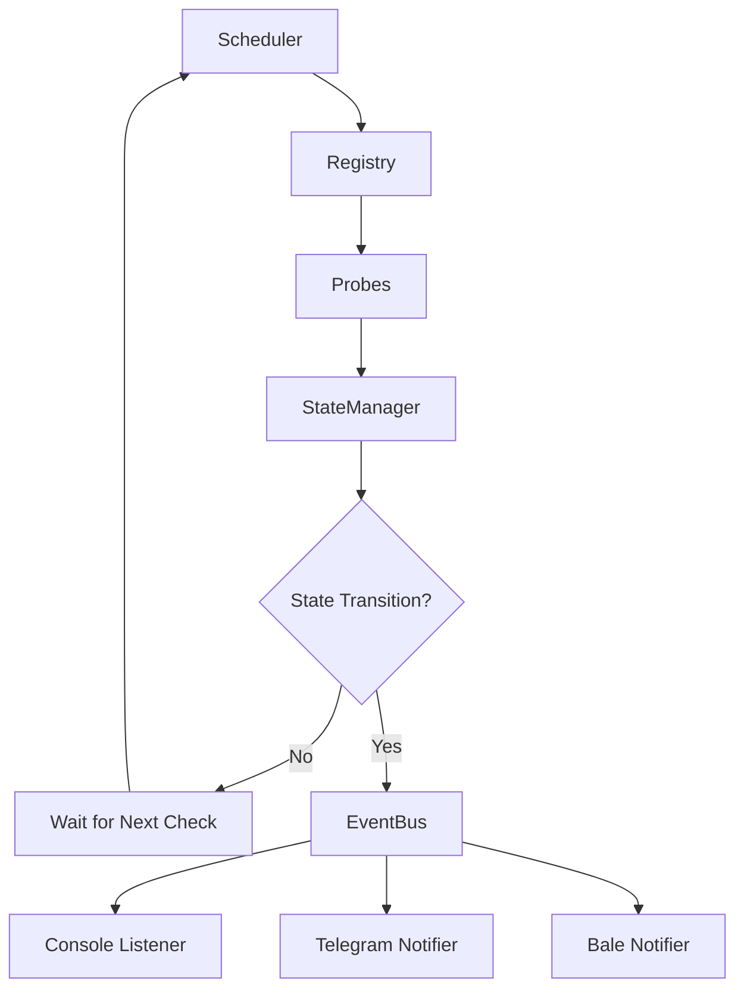
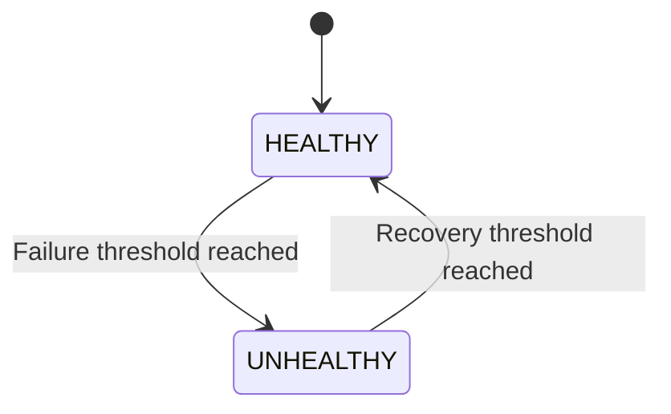

# ProbeWatch

A lightweight, extensible service health monitoring system built with TypeScript and Node.js.

ProbeWatch periodically checks the health of application and infrastructure services, tracks health state transitions, and sends notifications when services become unhealthy or recover.

It uses a modular probe architecture, threshold-based state management, and event-driven notifications to provide a simple and extensible monitoring solution.

## Features

- **Extensible probe architecture** — Monitor new services by implementing the `Probe` interface.
- **Service health monitoring** — Built-in probes for APIs, frontend applications, workers, Redis, PostgreSQL, PgBouncer, MongoDB, and Caddy.
- **Failure and recovery thresholds** — Prevent noisy alerts caused by temporary failures.
- **Event-driven architecture** — Decouple monitoring and state management from notification channels.
- **Multiple notification channels** — Console, Telegram, and Bale.
- **Latency tracking** — Measure probe execution latency and include it in health results and alerts.
- **Environment-based configuration** — Configure monitoring intervals and notification behavior through environment variables.
- **Docker support** — Multi-stage production image with development dependencies excluded.
- **TypeScript** — Strong typing across probes, events, results, and monitoring components.

## Architecture

ProbeWatch follows a modular, event-driven architecture.



### Core Components

| Component | Responsibility |
|---|---|
| Scheduler | Executes registered probes periodically. |
| Registry | Maintains the collection of registered probes. |
| Probes | Perform health checks against monitored services. |
| StateManager | Tracks health states and evaluates failure/recovery thresholds. |
| EventBus | Publishes monitoring events when meaningful state transitions occur. |
| Listeners | Consume monitoring events and handle notifications. |

## Project Structure

```text
src/
├── alerts/
│   ├── base.ts
│   ├── bale.listener.ts
│   ├── console.listener.ts
│   └── telegram.listener.ts
├── config/
│   ├── env.ts
│   └── index.ts
├── core/
│   ├── event-bus.ts
│   ├── monitor.ts
│   ├── registry.ts
│   ├── scheduler.ts
│   └── state-manager.ts
├── logger/
│   └── index.ts
├── probes/
│   ├── base.ts
│   ├── api.probe.ts
│   ├── bouncer.probe.ts
│   ├── caddy.probe.ts
│   ├── frontend.probe.ts
│   ├── mongo.probe.ts
│   ├── pg.probe.ts
│   ├── redis.probe.ts
│   └── worker.probe.ts
├── types/
│   ├── event-listener.ts
│   ├── monitor-event.ts
│   ├── probe-listener.ts
│   ├── probe-result.ts
│   └── probe.ts
└── index.ts
```

## How It Works

1. The `Scheduler` periodically triggers the monitoring process.
2. The `Registry` provides the collection of registered probes.
3. Each probe executes its health check and returns a result containing its status, latency, and optional message.
4. The `StateManager` evaluates the result and updates the service's health state.
5. Consecutive failures and successful checks are tracked against configured thresholds.
6. When a meaningful state transition occurs, the `EventBus` publishes a monitoring event.
7. Registered listeners consume the event and send notifications through their respective channels.

### Health State Transitions

A service transitions between `HEALTHY` and `UNHEALTHY` based on consecutive check results.



An alert is emitted only when the configured threshold is reached.

This helps prevent unnecessary notifications caused by isolated failures or temporary network issues.

## Monitored Services

The current implementation includes the following probes:

| Probe | Purpose |
|---|---|
| `ApiProbe` | Checks application API availability. |
| `WorkerProbe` | Checks background worker availability. |
| `RedisProbe` | Checks Redis availability. |
| `PostgresProbe` | Checks PostgreSQL availability. |
| `PgBouncerProbe` | Checks PgBouncer availability. |
| `MongoProbe` | Checks MongoDB availability. |
| `FrontendProbe` | Checks frontend application availability. |
| `CaddyProbe` | Checks Caddy availability. |

## Alert Channels

ProbeWatch supports multiple notification channels through event listeners.

### Console

Console logging is always registered and provides basic monitoring output.

### Telegram

Telegram notifications are registered when:

```env
NODE_ENV=production
```

### Bale

Bale notifications are also registered in production environments.

Notification channels are separated from the monitoring core, allowing additional listeners to be implemented without modifying the probe execution or state management logic.

## Configuration

Create an environment file using the provided example:

```bash
cp .env.sample .env
```

Configure the required environment variables in `.env`.

The configuration module handles environment-based settings for monitoring and notification behavior.

> Never commit your `.env` file or expose notification tokens and other secrets.

## Installation

### Prerequisites

- Node.js 22+
- npm

### Install dependencies

```bash
npm ci
```

### Development

```bash
npm run start:dev
```

### Build

```bash
npm run build
```

### Run the compiled application

```bash
npm start
```

The available scripts are defined in `package.json`.

## Docker

ProbeWatch includes a multi-stage Dockerfile designed for production deployment.

### Build the image

```bash
docker build -t probe-watch .
```

### Run the container

```bash
docker run --env-file .env probe-watch
```

### Production Image

The production image:

- Uses Node.js 22 Alpine.
- Installs dependencies in a builder stage.
- Compiles the TypeScript application.
- Excludes development dependencies.
- Runs as the non-root `node` user.
- Starts the compiled application from `dist/index.js`.

## Adding a New Probe

ProbeWatch uses an extensible `Probe` interface to define health checks.

To monitor a new service:

1. Implement the `Probe` interface.
2. Execute the required health check inside `check()`.
3. Return a `ProbeResult`.
4. Register the probe in `src/index.ts`.

### Example

```typescript
import { Probe } from "../types/probe";
import { ProbeResult } from "../types/probe-result";

export class ExampleProbe implements Probe {
  readonly id = "example";
  readonly displayName = "Example Service";

  async check(): Promise<ProbeResult> {
    return {
      status: "HEALTHY",
      latency: 0,
    };
  }
}
```

Register the probe:

```typescript
monitor.register(new ExampleProbe());
```

> This is a simplified example. A real probe should perform an actual health check and report its execution latency and failure details.

## Design Principles

- **Separation of concerns** — Probes, scheduling, state management, and notifications have independent responsibilities.
- **Extensibility** — New probes and notification listeners can be added without modifying the monitoring core.
- **Event-driven communication** — State transitions are communicated through events rather than direct dependencies on notification channels.
- **Noise reduction** — Failure and recovery thresholds help prevent unnecessary alerts.
- **Simple deployment** — A production-oriented Docker image simplifies deployment.

## License

This project is currently published without an open-source license.
